<div align="center">


# Painel Estatístico de Atendimentos · SAMU 192

[](https://painel-samu192.vercel.app)
[](https://painel-samu192.vercel.app)
[](https://neon.tech)
[](#testes)

**🟢 Sistema em produção, usado pela coordenação do SAMU 192 para apresentar a produtividade do serviço.**

🔗 **https://painel-samu192.vercel.app** (acesso restrito com senha)

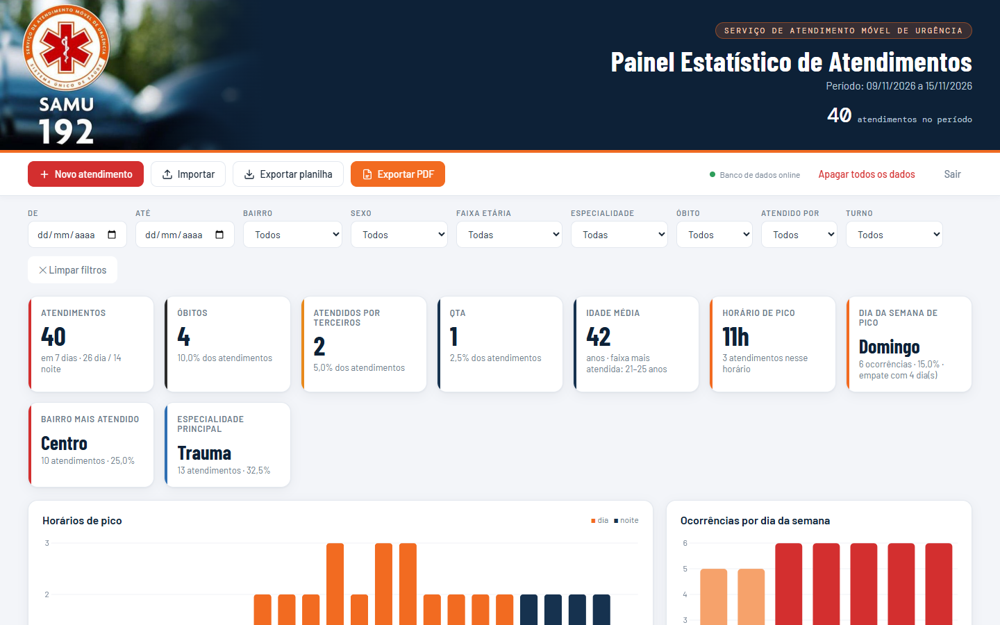

</div>

---

## O problema real que ele resolve

A coordenação precisa **mostrar a produtividade do SAMU** com números: quantos atendimentos foram feitos, em que horários e dias, em quais bairros, de quais especialidades e com quantos óbitos. Sem uma ferramenta, isso exige juntar registros à mão e montar gráficos a cada apresentação.

O painel resolve isso de ponta a ponta:

1. **A equipe lança cada atendimento** em segundos, pelo computador ou pelo celular.
2. **Os indicadores e gráficos se atualizam na hora**, para qualquer período, bairro ou especialidade.
3. **A coordenação apresenta** direto do painel ou gera um **relatório PDF** pronto para reunião.

Também registra corretamente as ocorrências em que o SAMU **foi acionado, mas não atendeu o paciente**: quando bombeiros ou familiares já o levaram (**Atendido por terceiros**) ou quando a ocorrência foi cancelada (**QTA**). Esses casos contam como acionamentos, sem distorcer idade, sexo e óbitos.

---

## Sumário

- [Funcionalidades](#funcionalidades)
- [Como usar](#como-usar)
- [Métricas calculadas](#métricas-calculadas)
- [Arquitetura em produção](#arquitetura-em-produção)
- [Segurança e privacidade](#segurança-e-privacidade)
- [Deploy (Vercel + Neon)](#deploy-vercel--neon)
- [Rodar localmente](#rodar-localmente)
- [Testes](#testes)
- [Estrutura do projeto](#estrutura-do-projeto)

---

## Funcionalidades

| | |
|---|---|
| 🟢 **Em produção** | Publicado na Vercel com banco Postgres (Neon), dados compartilhados entre todos os usuários |
| 🔐 **Acesso restrito** | Login com senha da coordenação, sessão em cookie seguro |
| 📝 **Cadastro diário** | Data, horário, bairro, idade, sexo, especialidade, óbito, **atendido por terceiros** e **QTA** |
| 📊 **9 indicadores** | Atendimentos, óbitos, terceiros, QTA, idade média, horário e dia de pico, bairro e especialidade principais |
| 📈 **8 gráficos** | Horários de pico, dia da semana, faixa etária, bairros, especialidades × óbitos, óbitos, sexo e evolução diária |
| 🔎 **Filtros** | Período, bairro, sexo, faixa etária, especialidade, óbito, atendido por (SAMU/terceiros/QTA) e turno |
| 📄 **PDF** | Relatório com logo, indicadores, gráficos, resumos e lista completa, pronto para apresentação |
| 📥 **Planilha** | Exporta CSV (abre no Excel), permite editar e importar de volta |
| 📱 **Responsivo** | Computador, tablet e celular |
| 🐳 **Docker** | Também roda isolado numa máquina local, sem banco |

---

## Como usar

### Acesso

Abra **https://painel-samu192.vercel.app** e entre com a senha da coordenação. A sessão dura 7 dias no mesmo navegador; use **Sair** em computadores compartilhados.

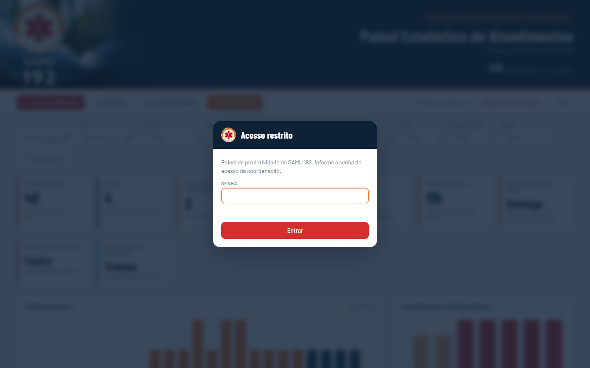

### 1. Lançar atendimentos

Clique em **Novo atendimento**. A data já vem preenchida com o dia atual, e bairro e especialidade sugerem valores já cadastrados. Marque **Óbito** quando o paciente evoluir a óbito.

Use **Salvar e cadastrar outro** para lançar vários atendimentos em sequência.

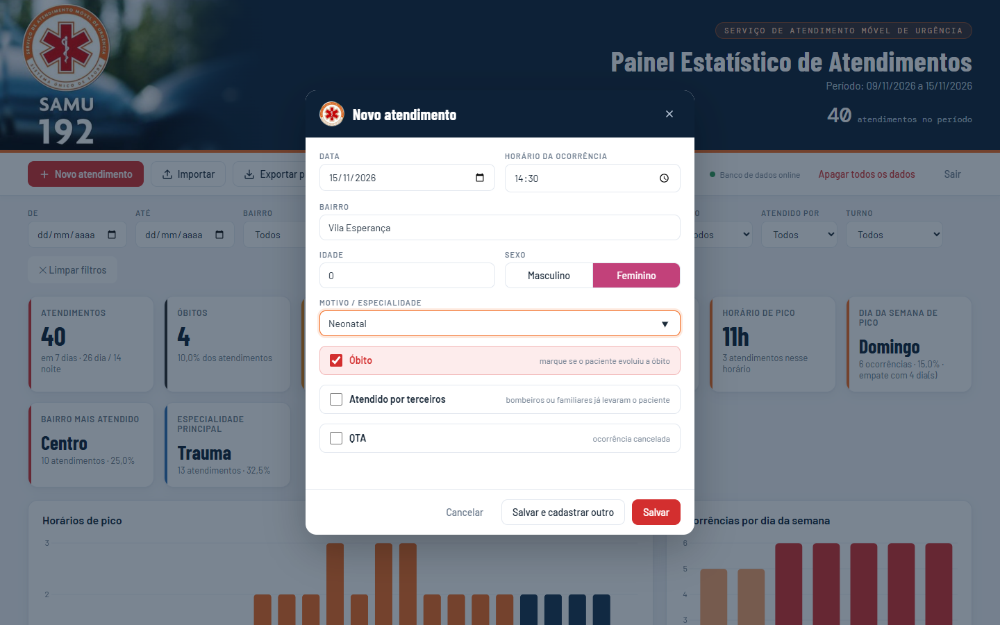

#### Atendido por terceiros e QTA

Quando o SAMU chega e **bombeiros ou familiares já levaram o paciente**, marque **Atendido por terceiros**. Quando a ocorrência é **cancelada**, marque **QTA**. Nos dois casos, **idade, sexo e óbito ficam desabilitados** e o registro guarda só data, hora, bairro e especialidade. As duas opções são exclusivas entre si.

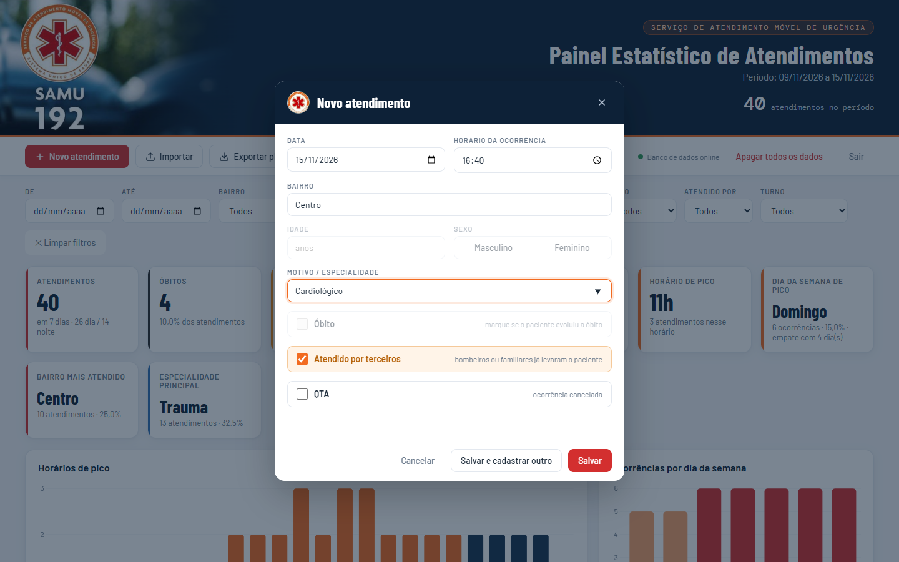

### 2. Filtrar e analisar

Todos os indicadores e gráficos respondem aos filtros. No exemplo: especialidade **Trauma** no turno **dia**.

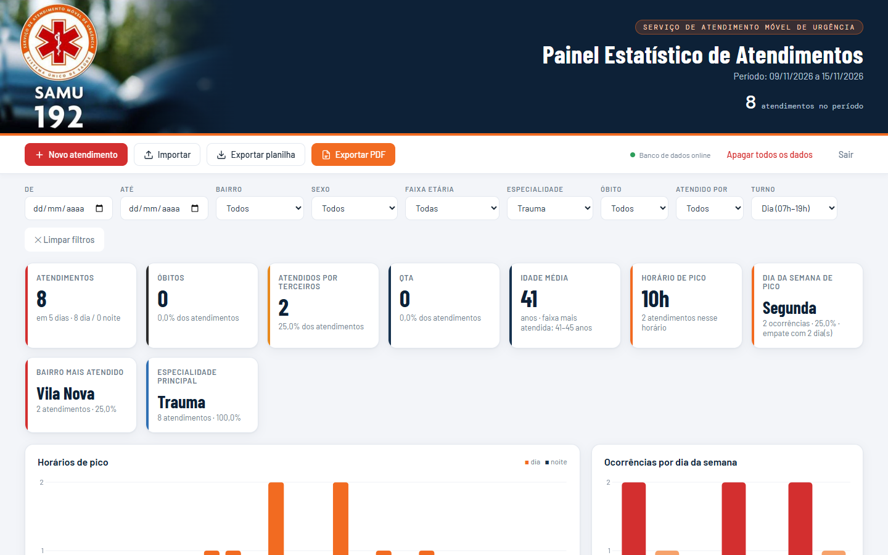

<details>
<summary><strong>Ver painel completo</strong></summary>

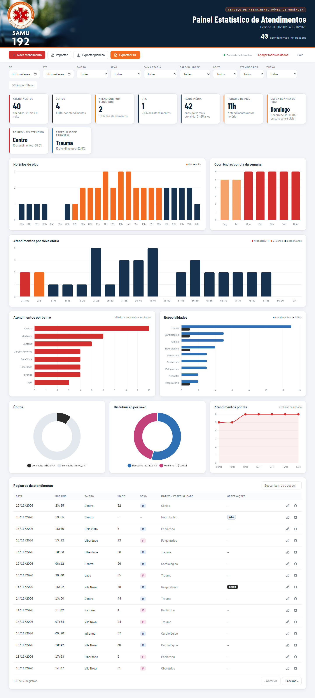

</details>

### 3. Registros

Tabela com busca, paginação e botões para **editar** ✏️ e **excluir** 🗑️. A coluna **Observações** destaca **ÓBITO**, **TERCEIROS** e **QTA**.

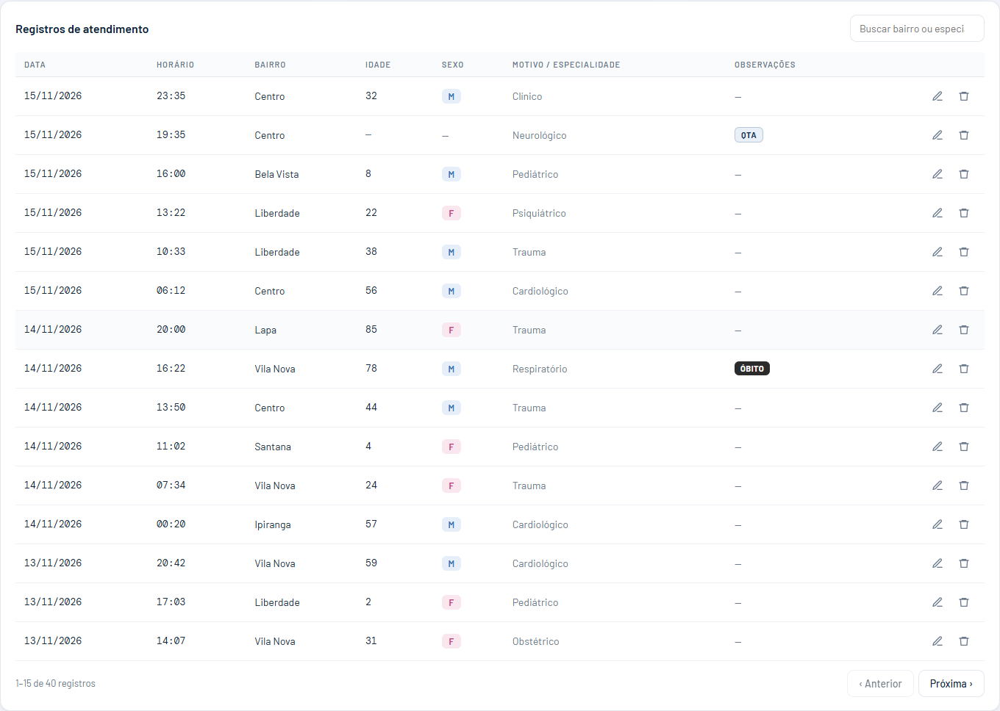

### 4. Importar e exportar planilha

- **Exportar planilha** gera um `.csv` que abre direto no Excel.
- Edite, corrija ou **acrescente colunas** (ex.: `unidade`), que são preservadas, inclusive no banco.
- **Importar** mostra um resumo e pergunta se deve **adicionar** aos dados atuais ou **substituir** tudo.

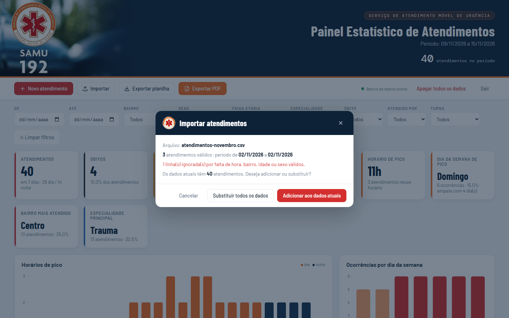

**Formato da planilha** (separador `;` ou `,`):

```csv
data;hora;bairro;idade;sexo;especialidade;obito;terceiros;qta
02/11/2026;08:15;Centro;0;F;Neonatal;Não;Não;Não
02/11/2026;09:30;Vila Nova;;;Trauma;Não;Sim;Não
02/11/2026;21:00;Lapa;67;F;Cardiológico;Sim;Não;Não
```

| Coluna | Obrigatória | Aceita |
|---|---|---|
| `data` | não (padrão: hoje) | `dd/mm/aaaa` ou `aaaa-mm-dd` |
| `hora` | sim | `08:15`, `8:15`, `8h` |
| `bairro` | sim | texto |
| `idade` | sim, exceto terceiros/QTA | número (0 a 120) |
| `sexo` | sim, exceto terceiros/QTA | `M`, `F`, `Masculino`, `Feminino` |
| `especialidade` | não | texto (também aceita `motivo`) |
| `obito` | não | `Sim`, `S`, `X`, `1` = óbito |
| `terceiros` | não | `Sim`, `S`, `X`, `1` = atendido por terceiros |
| `qta` | não | `Sim`, `S`, `X`, `1` = ocorrência cancelada |

### 5. Relatório em PDF

**Exportar PDF** gera um relatório A4 paisagem com os filtros aplicados, pronto para a apresentação da coordenação:

| Página | Conteúdo |
|---|---|
| 1 | Cabeçalho com logo, indicadores, horários de pico, dia da semana e faixa etária |
| 2 | Bairros, especialidades × óbitos, óbitos, sexo e evolução diária |
| 3+ | Resumos por especialidade, bairro, faixa etária e dia da semana (com óbitos, terceiros e QTA) |
| final | Lista completa de registros |

📎 [Baixar PDF de exemplo](docs/relatorio-exemplo.pdf)

| Página 1 | Página 2 | Resumos |
|---|---|---|
| 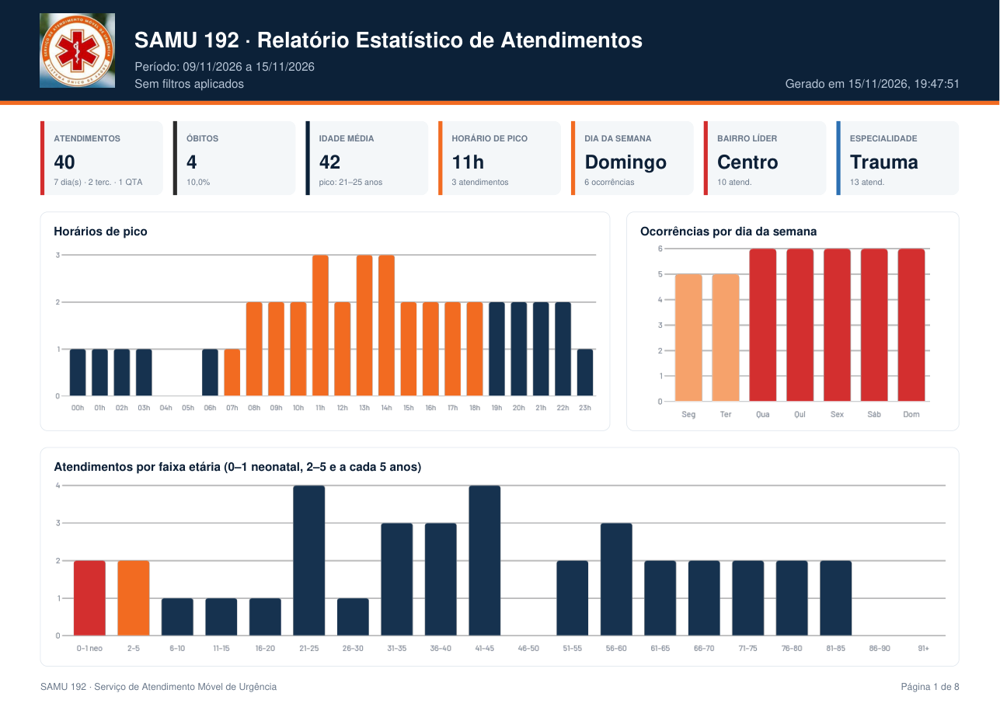 | 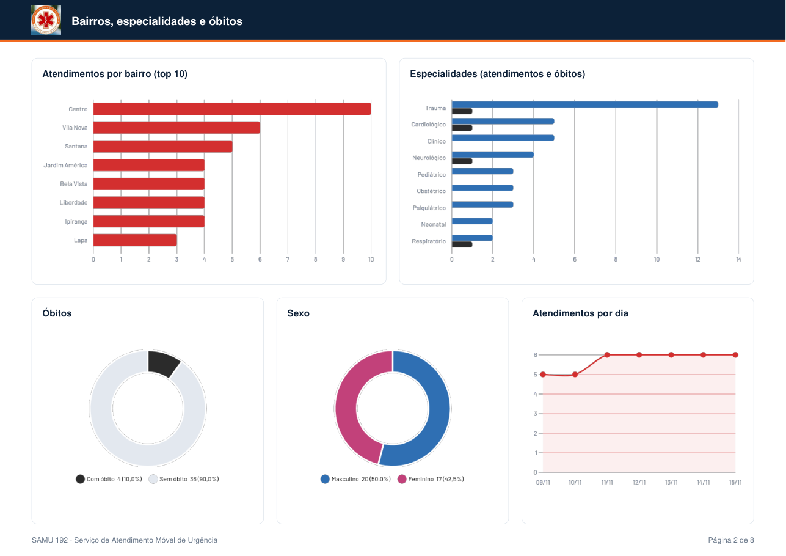 | 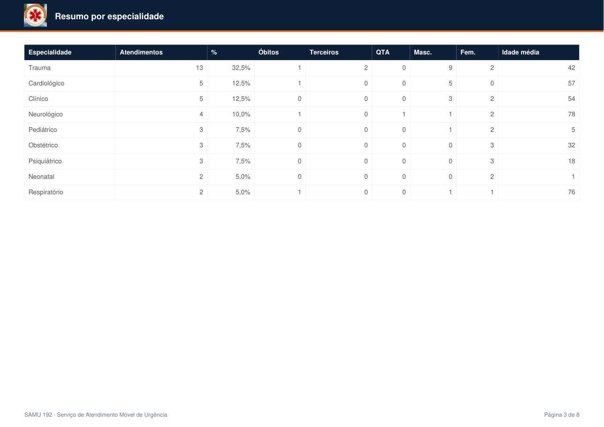 |

### 6. Celular

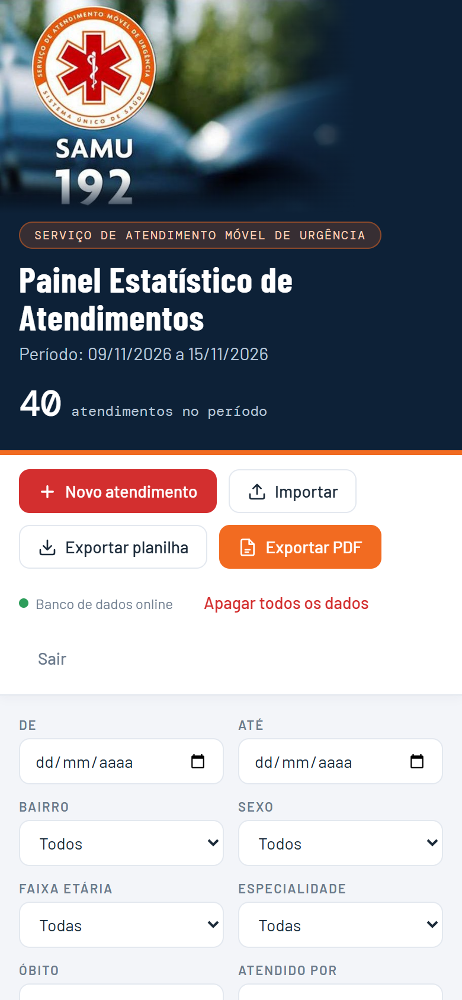

> As imagens desta documentação usam **dados fictícios**. Nenhum dado real de produção é exibido.

---

## Métricas calculadas

| Métrica | Como é calculada |
|---|---|
| **Faixa etária** | 0–1 ano (**neonatal**), 2–5 anos e depois **de 5 em 5 anos** (6–10 … 86–90, 91+) |
| **Horário de pico** | Hora cheia (00h–23h) com mais ocorrências. Dia = 07h–19h, noite = 19h–07h |
| **Dia da semana** | Dia (seg–dom) com mais ocorrências; indica empate quando houver |
| **Bairro** | Ranking dos 10 bairros com mais atendimentos |
| **Especialidades** | Atendimentos e óbitos por especialidade |
| **Óbitos** | Total e percentual sobre os atendimentos |
| **Terceiros / QTA** | Total e percentual de acionamentos sem atendimento ao paciente |
| **Idade média** | Média das idades informadas (terceiros e QTA não entram) e faixa mais atendida |

---

## Arquitetura em produção

```
 Navegador (index.html)                 Vercel (região gru1 · São Paulo)           Neon (sa-east-1 · São Paulo)
┌────────────────────────┐   HTTPS    ┌───────────────────────────────┐   SQL    ┌──────────────────────────┐
│ Painel, gráficos, PDF  │──────────▶│ /api/sessao       login/sair   │────────▶│ Postgres serverless      │
│ Chart.js · jsPDF       │◀──────────│ /api/atendimentos CRUD/import  │◀────────│ tabela atendimentos      │
└────────────────────────┘  cookie    └───────────────────────────────┘          └──────────────────────────┘
```

- **Frontend**: um único `index.html` (HTML, CSS e JavaScript puro), servido como arquivo estático pela CDN da Vercel.
- **API**: duas funções serverless Node.js em [`api/`](api/), com regras de negócio e validação em [`lib/`](lib/).
- **Banco**: [Neon](https://neon.tech) Postgres serverless, via driver HTTP `@neondatabase/serverless`. A tabela é criada automaticamente no primeiro acesso.
- **Funções e banco na mesma região (São Paulo)**, para respostas rápidas.
- **Plano gratuito** da Vercel (Hobby) e do Neon (Free).

O mesmo `index.html` também funciona **sem servidor**: quando não encontra a API (Docker, arquivo local), salva os dados no navegador (`localStorage`).

---

## Segurança e privacidade

O painel guarda dados de atendimentos de urgência. Por isso:

- **Sem nome, documento ou endereço do paciente**: só bairro, idade, sexo, especialidade e desfecho.
- **Toda a API exige login.** A senha fica numa variável de ambiente da Vercel, nunca no código.
- **Sessão em cookie `HttpOnly`, `Secure`, `SameSite=Strict`**, assinado com HMAC-SHA256 e válido por 7 dias.
- **Comparação de senha em tempo constante** e atraso nas tentativas erradas, contra adivinhação.
- **Validação no servidor** de todos os campos, com consultas parametrizadas (sem SQL injection).
- **Cabeçalhos de segurança**: HSTS, `X-Frame-Options: DENY`, `nosniff`, `Referrer-Policy`.
- Só `index.html`, `assets/`, `api/` e `lib/` são publicados (`.vercelignore`); testes, docs e segredos ficam de fora.

---

## Deploy (Vercel + Neon)

### Variáveis de ambiente

| Variável | Origem | Uso |
|---|---|---|
| `DATABASE_URL` | Criada pela integração Neon da Vercel | Conexão com o Postgres |
| `APP_SENHA` | Definida manualmente | Senha de acesso da coordenação |
| `APP_SEGREDO` | Definida manualmente (32+ caracteres aleatórios) | Assina os cookies de sessão |

### Do zero

```bash
npm i -g vercel
vercel login
vercel link                                  # cria/vincula o projeto
vercel integration add neon                  # cria o banco Neon (plano Free) e a DATABASE_URL
vercel env add APP_SENHA production          # digite a senha
vercel env add APP_SEGREDO production        # cole um valor aleatório longo
vercel deploy --prod
```

### Trocar a senha de acesso

```bash
vercel env rm APP_SENHA production
vercel env add APP_SENHA production
vercel deploy --prod
```

Para **desconectar todos os usuários**, troque também o `APP_SEGREDO`.

---

## Rodar localmente

### Com Docker (sem banco, dados no navegador)

```bash
git clone https://github.com/CarlosAlvesSantosJr/dashboard-atendimento.git
cd dashboard-atendimento
docker compose up -d --build     # http://localhost:8080
```

Porta ocupada? `PORTA=8085 docker compose up -d --build` (PowerShell: `$env:PORTA=8085; docker compose up -d --build`).

### Com Node, sem banco

```bash
npm start                        # http://localhost:8080
```

### Com Node, usando o banco Neon

```bash
vercel env pull .env.local       # baixa DATABASE_URL
# defina DATABASE_URL, APP_SENHA e APP_SEGREDO no terminal e rode:
API_LOCAL=1 npm start
```

---

## Testes

**31 testes end-to-end** com [Playwright](https://playwright.dev/) no Google Chrome. Os testes de API rodam **contra o Neon de verdade**, numa tabela isolada (`atendimentos_teste`) que é apagada ao final, sem tocar nos dados de produção.

```bash
npm install
vercel env pull .env.local                 # opcional: habilita os testes de banco
npm test
BASE_URL=http://localhost:8080 npm test    # testa o container Docker
```

| Grupo | O que é verificado |
|---|---|
| Carregamento | Dados de exemplo, indicadores, 8 gráficos, imagens |
| Regras de negócio | Faixas etárias, turno, dia da semana, normalização da importação |
| Cadastro | Novo, terceiros, QTA, salvar e cadastrar outro, validação, edição, exclusão, persistência, proteção contra HTML |
| Filtros | Sexo, óbito, atendido por, especialidade, faixa etária, período, limpar, busca |
| Importação / Exportação | CSV com `;` e acentos, mesclar, JSON antigo, CSV ida e volta, PDF |
| **API** | Bloqueio sem login, senha errada, cookie adulterado, CRUD, validação no servidor, SQL injection, importação de 300 registros |
| **Modo nuvem** | Login, gravação no banco, persistência após recarregar, exclusão e sair |
| Layout | Celular sem rolagem horizontal |

Sem Chrome instalado: `npx playwright install chromium` e `PW_CHANNEL=chromium npm test`.

Para regenerar as imagens: `npm run screenshots` e `python scripts/pdf-imagens.py` (requer `pip install pymupdf`).

---

## Estrutura do projeto

```
├── index.html              # Aplicação completa (HTML, CSS e JavaScript)
├── api/
│   ├── sessao.js           # Login, verificação de sessão e sair
│   └── atendimentos.js     # Listar, cadastrar, importar, editar e excluir
├── lib/
│   ├── auth.js             # Senha, cookie assinado (HMAC)
│   ├── db.js               # Neon: tabela, validação e consultas
│   └── http.js             # Respostas JSON e tratamento de erros
├── assets/                 # Imagens do SAMU (cabeçalho, logo, PDF)
├── docs/                   # Capturas de tela e PDF de exemplo
├── tests/
│   ├── dashboard.spec.js   # Testes da interface
│   ├── api.spec.js         # Testes da API e do modo nuvem (Neon)
│   └── server.js           # Servidor local (estático + API opcional)
├── scripts/                # Geração das imagens da documentação
├── vercel.json             # Região, cabeçalhos de segurança e cache
├── Dockerfile · nginx.conf · docker-compose.yml
└── playwright.config.js
```

**Tecnologias:** JavaScript · Node.js · Vercel Serverless Functions · Neon Postgres · [Chart.js](https://www.chartjs.org/) · [jsPDF](https://github.com/parallax/jsPDF) · Playwright · Docker · nginx
